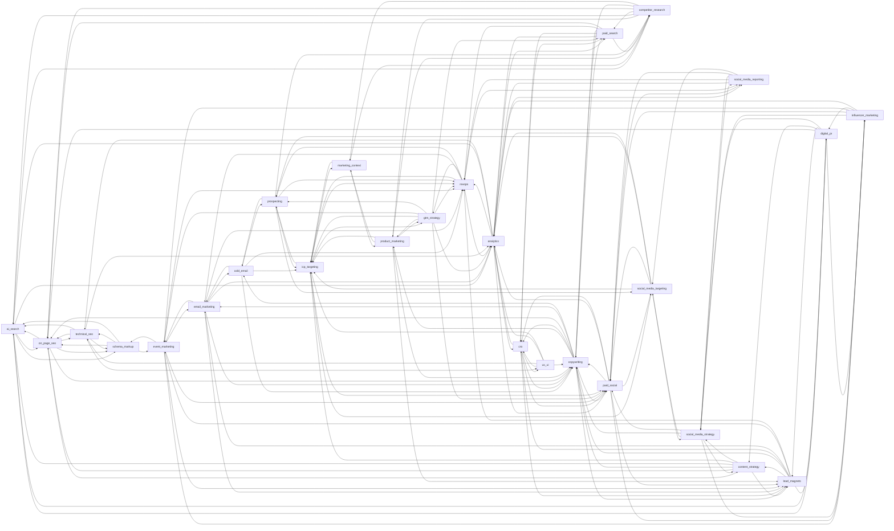

# Skill Map

Every skill reads `.agents/marketing-context.md` (created by `marketing-context`). Arrows show "Related Skills" handoffs.

## Common workflows

| Goal | Skill chain |
|---|---|
| Launch a product | marketing-context → product-marketing → gtm-strategy → copywriting → lead-magnets → paid-social / email-marketing → analytics |
| Rank and get cited for a topic | content-strategy → on-page-seo → schema-markup → technical-seo → ai-search → digital-pr |
| Build outbound pipeline | icp-targeting → prospecting → cold-email → revops |
| Run an ABM program | icp-targeting → social-media-targeting → paid-social → prospecting → event-marketing → revops |
| Improve conversion | analytics → cro → ux-ui → copywriting |
| Prove social ROI | social-media-strategy → social-media-reporting → revops |
